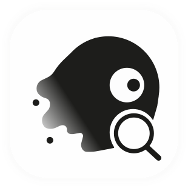

<div align="center">
  

  <br />

# Search Mini

**Um espaço de busca minimalista para web, YouTube, música e seus favoritos.**

</div>

## Sobre

O Search Mini reúne diferentes formas de pesquisar e organizar conteúdo em uma interface compacta. Escolha um mecanismo de busca, explore vídeos do YouTube, monte uma playlist ou guarde atalhos no Workspace — com preferências e dados salvos localmente no navegador.

## Recursos

- **Busca na Web:** Google, DuckDuckGo, Brave e Bing em um único seletor.
- **YouTube:** pesquisa de vídeos e canais, reprodução em janela dedicada e inscrições locais para acompanhar novos vídeos.
- **Música:** crie uma playlist a partir de URLs do YouTube. Reordene faixas, controle a reprodução, use repetição e modo aleatório, e organize a lista sem duplicatas.
- **Workspace:** salve atalhos para seus sites. Digite `add: Nome do favorito` para criar um cartão; consultas comuns podem ser encaminhadas ao mecanismo de busca padrão.
- **Temas:** Sistema, Claro, Escuro, Preto e Pastel, com transição suave ao trocar a aparência.
- **Personalização:** modo monocromático para miniaturas e opções de configuração para YouTube e Workspace.
- **Importação e exportação:** faça backup de configurações, cartões, inscrições, playlist e outros dados do aplicativo em JSON.
- **Interface adaptável:** menus e submenus se ajustam a telas menores; em dispositivos touch, submenus podem ser abertos com um toque.

## Como usar

1. Use o seletor à esquerda da barra de pesquisa para escolher uma sessão ou mecanismo de busca.
2. No computador, passe o cursor sobre **Web**, **Tema** ou **Data** para abrir as opções. Em dispositivos touch, toque para expandir.
3. Na sessão **Música**, cole uma URL de vídeo do YouTube na barra de pesquisa para adicionar uma faixa à playlist.
4. Na sessão **Workspace**, digite `add: Nome do favorito` para criar um cartão.
5. Abra **Data** no menu para exportar ou importar um backup.
6. Acesse os créditos no final do menu para encontrar o desenvolvedor nas redes sociais.

### Configuração do YouTube

A busca de vídeos e canais requer uma chave da **YouTube Data API v3**. Configure-a nas opções do aplicativo ou crie um arquivo `.env.local` na raiz:

```env
VITE_YOUTUBE_API_KEY=sua_chave_da_api
```

O modo Música usa o player incorporado do YouTube e não exige essa chave para adicionar URLs à playlist.

## Executar localmente

**Requisitos:** Node.js 16 ou superior e npm.

```bash
npm install
npm run dev
```

O servidor de desenvolvimento é iniciado na porta `3000`.

Comandos adicionais:

```bash
npm run lint   # Verificação de tipos TypeScript
npm run build  # Build de produção
npm run preview
```

## Tecnologias

- React e TypeScript
- Vite
- Tailwind CSS
- Lucide React
- Motion
- YouTube Data API v3
- LocalStorage para persistência local

## Desenvolvedor

**Gui23x**

- [GitHub](https://github.com/gui23x)
- [Instagram](https://www.instagram.com/dsngui)
- [LinkedIn](https://www.linkedin.com/in/guilherme-gomes-da-silva/?locale=en)
